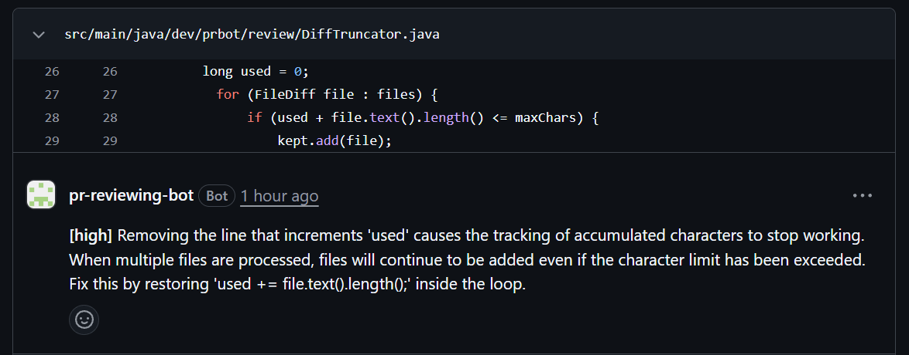

# PR Review Bot

A GitHub App that reviews pull requests with an LLM. Open a PR and the bot posts a review with inline comments on bugs, security
problems and correctness issues, with a severity on each. It does not comment on style. It runs entirely on free tiers
(Gemini free tier, Neon Postgres, Render, UptimeRobot).



- **Install:** https://github.com/apps/pr-reviewing-bot
- Reviews are posted as `COMMENT` only. The bot can never approve or request changes.
- A small React dashboard (login required) shows review history, stats, tokens and latency.

## How it works

```
GitHub ──webhook──▶ WebhookController ──▶ ReviewService (bounded executor)
                     (HMAC check)            │ 1. dedupe in DB (repo, PR, head SHA)
                                             │ 2. GitHubClient.fetchDiff (App installation token)
                                             │ 3. filter files, batch at file boundaries, DiffAnnotator
                                             │ 4. LlmClient.review (Gemini / Groq / Claude, JSON-schema output)
                                             │ 5. drop comments outside the diff, apply .prbot.yml
                                             ▼ 6. GitHubClient.postReview, update the review row

React (served from Spring) ──▶ /api/login, /api/reviews, /api/stats ──▶ Postgres
```

Skipped on purpose: draft PRs, PRs by bots (Dependabot, Renovate), lockfiles, minified or generated files, binaries, vendored
paths, and PRs whose filtered diff is empty. Every PR gets a row in the database: `POSTED`, `FAILED` or `SKIPPED` with a reason.
A redelivered webhook for the same PR and commit never produces a second review.

## Data handling

**The diff of every reviewed PR is sent to the configured LLM provider.** Source code from private repositories leaves your
infrastructure. Some free tiers (Gemini's included) may use prompts to improve the provider's products, so **install the bot on
public repositories only**, or self-host with a paid tier or a provider whose terms you accept.

The database stores metadata only: repository, PR number, commit SHA, status, provider, model, token counts, latency and an error
reason. It does not store the diff or the text of the comments. Secrets are never logged.

## Run it locally (about 5 minutes)

Needs JDK 21, Maven, Node 22 (for the dashboard) and Docker (for Postgres).

1. Start Postgres: `docker compose up -d postgres`
2. Create a git-ignored `.env` in the project root (read automatically at startup):
   ```bash
   GITHUB_TOKEN=ghp_...                    # fine-grained PAT: Pull requests (rw), Contents (r)
   GITHUB_WEBHOOK_SECRET=some-long-random-string
   ADMIN_PASSWORD=at-least-12-characters   # dashboard login (user name: admin)
   GEMINI_API_KEY=...                      # free key from Google AI Studio
   ```
   For a GitHub App instead of a PAT, set `GITHUB_AUTH=app`, `GITHUB_APP_ID` and `GITHUB_APP_PRIVATE_KEY`.
3. Run `mvn spring-boot:run` and, in another terminal, `ngrok http 8080`.
4. In your test repo: Settings, Webhooks, payload URL `https://<ngrok>/webhook/github`, content type `application/json`, the same
   secret, event "Pull requests".
5. Open a PR. The review appears on the PR within a minute.

The app refuses to start if the GitHub credentials, the webhook secret, the admin password or the API key of the selected
provider is missing. For the dashboard: `cd frontend && npm ci && npm run dev` (proxies `/api` to port 8080). To run everything
in one container: `docker compose --profile app up --build`.

`mvn verify` runs the tests and the formatting check; `mvn spotless:apply` fixes formatting. `cd frontend && npm run lint && npm test`
for the frontend. Database tests use Testcontainers and skip themselves when Docker is not available.

## Deploy on free tiers

1. **Neon:** create a free Postgres project and note the JDBC URL (`jdbc:postgresql://<host>/<db>?sslmode=require`).
2. **GitHub App:** permissions Pull requests (read and write), Contents (read), Metadata (read); subscribe to Pull request events;
   webhook URL `https://<your-render-host>/webhook/github` and the webhook secret.
3. **Render:** New, Blueprint, pick this repo (`render.yaml`). Fill in the secrets it asks for (App ID and private key, webhook
   secret, Gemini key, admin password, database URL, user and password). Flyway creates the schema on startup.
4. **UptimeRobot:** a 5-minute HTTP check on `/actuator/health` keeps the free instance awake and emails you on downtime.

## Configuration

| Property | Env var | Default | Notes |
|----------|---------|---------|-------|
| `prbot.github.auth` | `GITHUB_AUTH` | `pat` | `pat` (local dev, one token) or `app` (GitHub App, works on every repo it is installed on) |
| `prbot.github.token` | `GITHUB_TOKEN` | – | Required when `auth=pat` |
| `prbot.github.app-id` | `GITHUB_APP_ID` | – | Required when `auth=app` |
| `prbot.github.app-private-key` | `GITHUB_APP_PRIVATE_KEY` | – | Required when `auth=app`. The `.pem` text GitHub gives you (PKCS#1 or PKCS#8); literal `\n` sequences are accepted so it fits on one env line |
| `prbot.webhook-secret` | `GITHUB_WEBHOOK_SECRET` | – (required) | Webhook HMAC secret |
| `prbot.llm.provider` | `LLM_PROVIDER` | `gemini` | `gemini`, `groq` or `claude` |
| `prbot.llm.gemini.api-key` / `.model` | `GEMINI_API_KEY` | – / `gemini-3.5-flash-lite` | |
| `prbot.llm.groq.api-key` / `.model` | `GROQ_API_KEY` | – / `openai/gpt-oss-120b` | Free tier caps at ~8k tokens/min, so only small diffs fit |
| `prbot.llm.claude.api-key` / `.model` | `ANTHROPIC_API_KEY` | – / `claude-sonnet-5-5` | Only needed when `provider=claude` |
| `prbot.max-diff-chars` | – | `60000` | Size budget for the diff sent to the model. Whole files only: files that do not fit are skipped and named in the review summary |
| `prbot.http.connect-timeout` | – | `10s` | Connect timeout for GitHub and LLM calls |
| `prbot.http.read-timeout` | – | `60s` | Read timeout for GitHub and LLM calls |
| `prbot.http.max-attempts` | – | `3` | Tries per call on HTTP 429, 5xx or network errors |
| `prbot.http.retry-base-delay` | – | `1s` | First backoff, doubled each retry (a `Retry-After` header wins) |
| `prbot.http.retry-max-delay` | – | `30s` | Upper bound for any single wait |
| `spring.datasource.url` / `.username` / `.password` | `DB_URL`, `DB_USER`, `DB_PASSWORD` | local Postgres from `docker-compose.yml` | JDBC URL, e.g. Neon: `jdbc:postgresql://<host>/<db>?sslmode=require`. Flyway creates the schema on startup. The DB is not part of `/actuator/health`, so uptime pings do not keep Neon awake |
| `prbot.max-comments` | – | `15` | Hard upper bound on inline comments per review (`.prbot.yml` strictness can only lower it) |
| `prbot.max-batch-chars` | – | `24000` | Diff characters per model request. A bigger PR is reviewed in several requests, each with its own set of files. Lower it (about `12000`) for Groq's free tier |
| `prbot.quota.requests-per-minute` | – | `12` | Model requests are spaced evenly to stay under this. Default leaves headroom under Gemini's 15 RPM |
| `prbot.quota.daily-limit` | – | `450` | Model requests per day, counted in the database. When used up, new reviews are recorded as SKIPPED and nothing is posted. Default leaves headroom under Gemini's 500 RPD |
| `prbot.quota.reset-zone` | – | `America/Los_Angeles` | Time zone in which the day (and the provider's quota) rolls over |
| `prbot.admin.username` | `ADMIN_USERNAME` | `admin` | User name of the dashboard login |
| `prbot.admin.password` | `ADMIN_PASSWORD` | – (required, 12+ chars) | Password of the dashboard login (`POST /api/login`). The app refuses to start without it |
| `server.servlet.session.cookie.secure` | `SESSION_COOKIE_SECURE` | `true` | Session cookie is HttpOnly and SameSite=Strict. Set `false` only to test over plain http on a non-localhost host |
| `prbot.executor.threads` | – | `2` | Concurrent reviews |
| `prbot.webhook.max-bytes` | - | `1048576` | Largest accepted webhook body in bytes; bigger or length-less requests get 413 or 411 before the body is read |
| `prbot.github.api-url` / `prbot.llm.gemini.base-url` | - | the real APIs | Only changed by the end-to-end tests, which point them at a fake server |
| `prbot.executor.queue-capacity` | – | `20` | Waiting reviews; beyond this the webhook gets 503 and the review is skipped |
| `VITE_GITHUB_APP_URL` | – (build time, frontend) | empty | Public install URL of the GitHub App (`https://github.com/apps/<name>`). The landing page shows a disabled install button until it is set |
| `VITE_REPO_URL` | – (build time, frontend) | empty | Optional link to the source repo, shown in the site footer |

## Per-repo settings: `.prbot.yml`

Put a `.prbot.yml` in the root of a repository. It is read from the pull request's **base branch**, so a PR cannot change its own review rules.

```yaml
# Files to leave out of the review, on top of lockfiles, generated and vendored files.
ignore:
  - docs/          # a directory: everything below it
  - "*.md"         # no slash: matches at any depth
  - /build         # leading slash: only at the repo root
  - src/**/gen/**  # ** crosses directories, * stays inside one

# low:    only high severity findings, at most 5 comments
# normal: medium and high, at most 10 comments (default)
# high:   everything, at most 15 comments
strictness: normal
```

Unknown keys, a wrong type or invalid YAML make the bot ignore the whole file and use the defaults. The review summary says so. `prbot.max-comments` stays an upper bound.

## Project layout

Packages under `dev.prbot`: `webhook`, `review`, `github`, `llm`, `http`, `config`, `persistence`, `api`, `metrics`. The React app is in
`frontend/`. The development history and decisions are in [DEVELOPMENT_PLAN.md](DEVELOPMENT_PLAN.md).

## Contributing and security

See [CONTRIBUTING.md](CONTRIBUTING.md). Report vulnerabilities privately as described in [SECURITY.md](SECURITY.md).

## License

[MIT](LICENSE)
